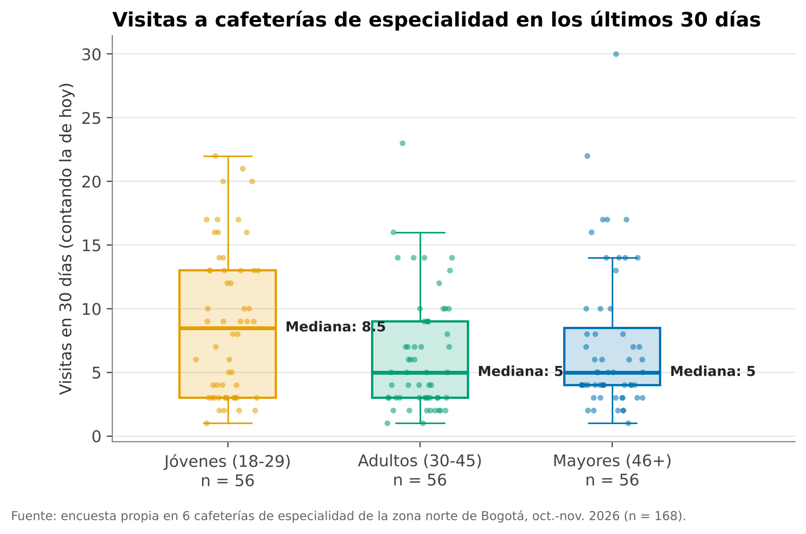
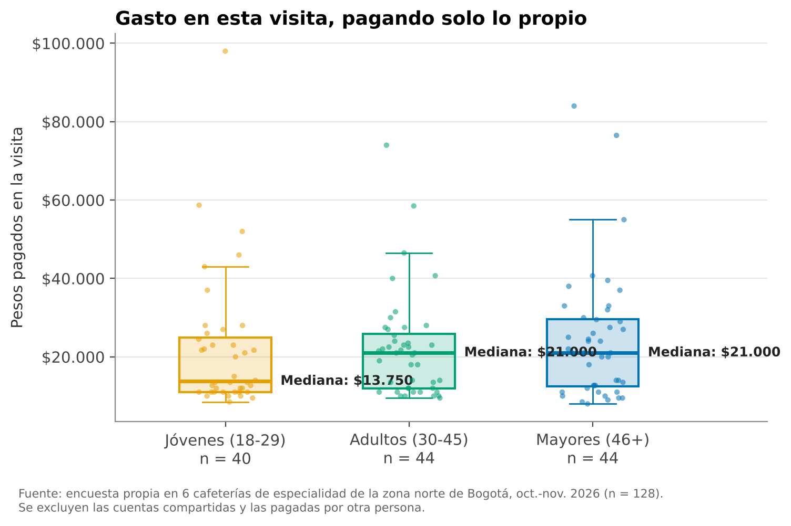
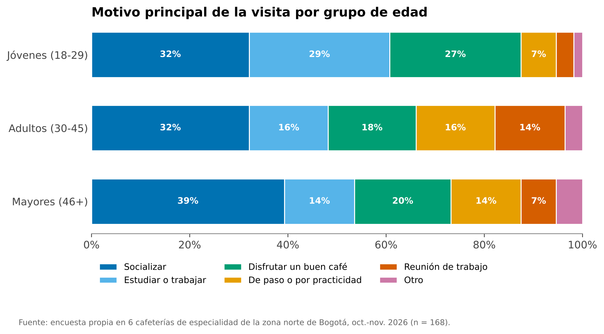
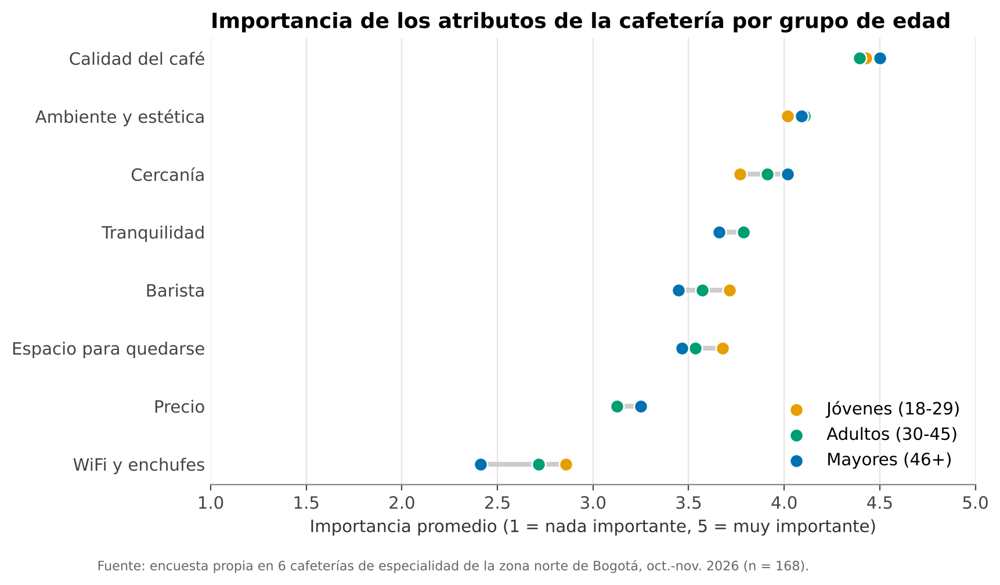

# Proyecto Final Haciendo Economía
# Edad y demanda de café de especialidad en Bogotá

## Pregunta de investigación

¿De qué manera se relaciona la edad con las formas de consumir café de especialidad, medidas por frecuencia de visita y gasto por visita, en las cafeterías de especialidad de la zona norte de Bogotá (Chicó, Parque 93 y Zona T) y qué motivos y atributos de la oferta se asocian con esas diferencias?

## ¿Por qué esta pregunta?

El auge del café de especialidad suele atribuirse a los jóvenes, pero en Bogotá no hay datos que lo confirmen. La literatura internacional muestra que la edad sí se
relaciona con la demanda de café, aunque en sentidos distintos según la medida: el consumo total aumenta con la edad, las visitas a cafeterías se concentran en los
jóvenes y los mayores gastan más por visita. Ningún estudio revisado lo ha medido para Colombia ni a escala de zona.

## Estructura del repositorio

`Documentación/` -> Entrega 1 y 2a, Entrega 2b, Entrega 3a y 3b corregidas, Entrega 4

`Documentos/` -> Documentos finales y corregidos de las entregas, resultados encuestas

`Mapa/` -> Script construcción del shapefile del mapa con la verdadera escala

`Scripts/` -> Script del informe de campo

## Equipo

- Alejandro Cotrino
- Emanuel Hernández
- Samuel Mora
- Sara Vásquez
- Manuela Vergara

## Entrega 5: datos finales

Resultado del campo: 168 encuestas válidas de 233 personas abordadas (tasa de respuesta del 72%), 56 por grupo de edad.

| Archivo | Qué es |
|---|---|
| `Datos/raw/encuestas_raw.xlsx` | Datos raw: las 233 personas abordadas, la bitácora y el diccionario |
| `Datos/raw/encuestas_raw_original.numbers` | Archivo original de captura |
| `Scripts/01_limpieza.py` | Limpia los datos: deja las encuestas válidas, convierte tipos, crea `grupo_edad` y otras variables, y revisa la calidad |
| `Datos/clean/encuestas_clean.csv` y `.xlsx` | Datos clean/tidy: 168 filas, una por persona; el Excel incluye el diccionario |
| `Datos/clean/abordajes.csv` | Las 233 personas abordadas, con el indicador `valida` |
| `Datos/clean/resumen_por_grupo.csv` | Medianas por grupo de edad |
| `Scripts/02_graficos.py` | Genera los 10 gráficos de `Graficos/` |
| `Scripts/Entrega5_Colab.ipynb` | Notebook para correr todo en Google Colab |

### Cómo replicarlo

**En Google Colab (sin instalar nada):** abran `Scripts/Entrega5_Colab.ipynb` en [colab.research.google.com](https://colab.research.google.com) (Archivo → Subir notebook), suban el `.zip` del repositorio cuando lo pida y den Ejecutar todo.

**En su computador**, desde la carpeta del repositorio:

```bash
pip install pandas openpyxl matplotlib
python Scripts/01_limpieza.py
python Scripts/02_graficos.py
```

### Gráficos

| | |
|---|---|
|  |  |
|  |  |
